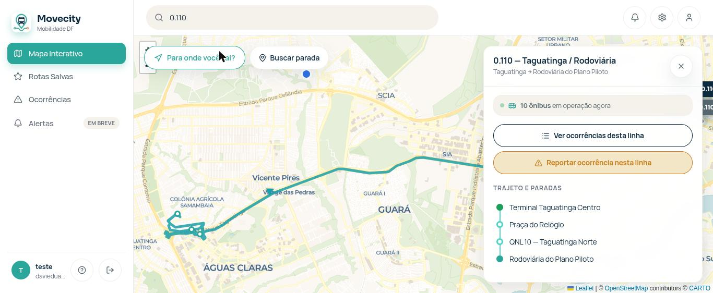
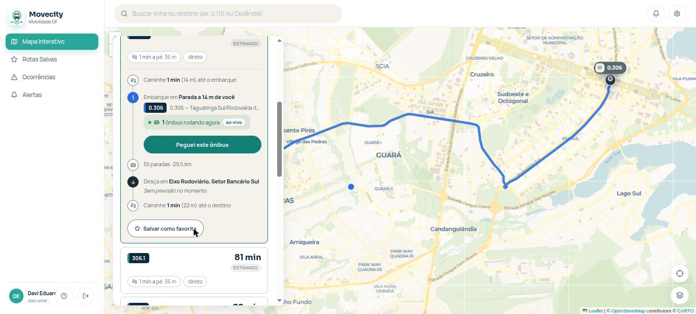
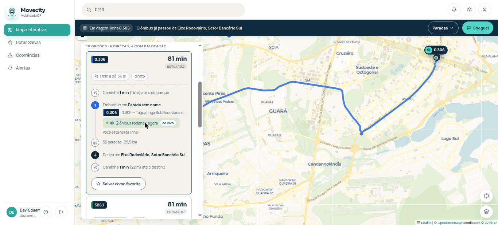
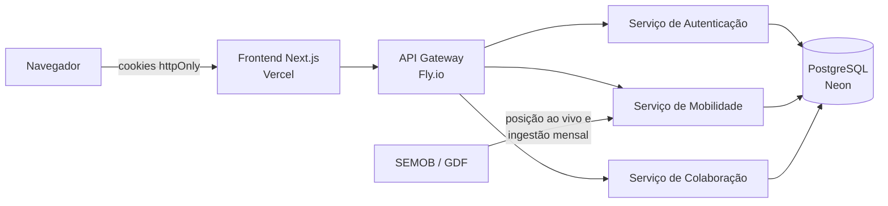

# Movecity

**Mobilidade urbana colaborativa no Distrito Federal.** Um aplicativo web que combina a posição oficial dos ônibus (GPS da SEMOB/GDF) com reportes dos próprios passageiros, para reduzir o "ônibus fantasma" e a espera em paradas inseguras. Projeto-piloto em Taguatinga e Ceilândia.

[](https://github.com/davieduardo001/tcc-ciencia-computacao-ucb/actions/workflows/ci.yml)

| | |
|---|---|
| **Aplicativo** | <https://movecity-frontend.vercel.app> |
| **API (Gateway)** | <https://movecity-gateway.fly.dev/docs> |
| **Defesa** | 13/11/2026, UCB. Roteiro em [`docs/guia-apresentacao.md`](docs/guia-apresentacao.md) |
| **Trabalho de Conclusão de Curso** | Ciência da Computação, Universidade Católica de Brasília. Grupo Segurança no Transporte |

<table>
  <tr>
    <td width="33%"><br><sub>Linha no mapa, com trajeto, paradas e ônibus em operação.</sub></td>
    <td width="33%"><br><sub>Rota até o destino: embarque, ônibus rodando agora e desembarque.</sub></td>
    <td width="33%"><br><sub>Viagem em andamento, com a faixa "Em viagem" no topo.</sub></td>
  </tr>
</table>

## O problema

- **Ônibus fantasma:** veículos que constam no sistema oficial mas não passam, ou passam fora do horário sem aviso.
- **Insegurança:** esperar muito tempo em paradas isoladas e mal iluminadas expõe a assaltos e violência.
- **Assimetria de informação:** a posição real dos veículos raramente chega ao cidadão de forma confiável.

Segundo a Pesquisa Distrital por Amostra de Domicílios (IPEDF, 2022), 33,3% da população do DF usa o ônibus como principal meio de transporte. O contexto completo está no [Documento de Visão](docs/documento_visao.md).

## O que o aplicativo faz

- **Mapa** com a sua localização, busca de linha pelo número e **ônibus em tempo real** sobre o trajeto.
- **Tempo de chegada** do ônibus à sua parada, sempre com a origem do número: "ao vivo" (posição real) ou "previsto" (horário). Sem dado, diz "Sem previsão no momento".
- **Parada:** linhas que passam, "Chegando nesta parada" e próximas saídas do terminal.
- **Rota** de uma origem a um destino por ônibus, com baldeação, e busca de lugar por nome ou endereço.
- **Viagem:** "Peguei este ônibus", progresso até a parada de descida e aviso quando o ônibus se aproxima.
- **Colaboração:** reportar e ver ocorrências na linha (atraso, lotação, obra, acidente, segurança), com limite de reportes por hora e validade de 60 minutos.
- **Rotas favoritas**, **preferências de alerta**, tutorial no primeiro acesso.
- **Conta:** cadastro e login por e-mail e senha ou Google, renovação automática da sessão e recuperação de senha por e-mail.

### Limites conhecidos

- **Alertas não chegam ao aparelho:** a tela de preferências salva, mas o push (#207) e o alerta de cancelamento (#28) não foram entregues.
- **Embarque com raio de 100 km** em produção: aberto só para demonstrar o "Peguei este ônibus" sem precisar estar dentro de um ônibus. A regra de uso real é 100 m.
- **Sem confirmação de conta por e-mail:** o e-mail só é usado para recuperar a senha.
- **Sem ambiente de homologação separado** (decisão de custo): `homolog` publica na produção da Vercel.

## Como funciona



- O **Gateway** é o ponto único de entrada: lê o JWT do cookie httpOnly, valida localmente e roteia para o serviço certo. Os serviços de domínio recebem a identidade do usuário já validada.
- **Sem PostGIS:** a geometria fica em colunas JSON. Os dados da rede da SEMOB são copiados para o banco por ingestão mensal; a posição dos ônibus é lida ao vivo e nunca persistida.
- **LGPD:** a posição do usuário serve só para validar o embarque e é descartada; a viagem não guarda trilha de posição.
- As decisões, com os motivos, estão no [Documento de Arquitetura](docs/documento_arquitetura.md), seção 10.

| Camada | Tecnologia |
|---|---|
| Frontend | Next.js (App Router), Leaflet com base CARTO sobre OpenStreetMap |
| Backend | FastAPI (Python), 4 aplicações independentes no Fly.io: gateway, auth, mobilidade, colaboração |
| Banco | PostgreSQL no Neon |
| Dados | API da SEMOB/GDF (GeoJSON), OSRM, Google OAuth |
| CI/CD | GitHub Actions: testes, deploy no Fly.io e na Vercel, ingestão mensal da SEMOB |

## Desenvolvimento com agentes de IA

**Todo o código foi gerado por agentes de IA, conduzidos por seis estudantes que especificaram, revisaram e aprovaram.** A IA escreveu; o processo e as pessoas garantiram a qualidade.

```
issue → cenários BDD → diagrama de sequência → PR → CI → revisão → homolog → main
```

- A IA não faz merge nem bypass de proteção de branch sem a pessoa responsável pedir. Regras em [`docs/boas-praticas-ia.md`](docs/boas-praticas-ia.md).
- Skills, agentes e configurações de cada ferramenta (Claude Code, OpenCode, Gemini) ficam centralizados em [`ai/`](ai/README.md). Depois de clonar, rode `./ai/instalar.sh`.
- O ciclo completo, do backlog ao deploy, está no [Manual de Sprint](docs/manual-sprint.md).

## Qualidade

| Medida | Valor | Fonte |
|---|---|---|
| Testes automatizados | **1.260** passando (671 backend, 589 frontend) | medido em 16/10/2026 |
| Cobertura | backend **93,7%**, frontend **89,1%** | idem |
| Casos de teste manuais | **49 de 49 executados em produção**: 33 aprovados, 10 com ressalva, 1 reprovado por configuração, 3 só em campo, 2 pendentes | [`docs/qa/execucao-casos-p1.md`](docs/qa/execucao-casos-p1.md), 28/10/2026 |
| Defeitos catalogados | **24**, com causa e como foram detectados | [`docs/qa/relatorio-cobertura-e-defeitos.md`](docs/qa/relatorio-cobertura-e-defeitos.md) |
| Usabilidade | 10 heurísticas de Nielsen avaliadas por um avaliador, de forma agêntica | [`docs/qa/avaliacao-usabilidade-nielsen.md`](docs/qa/avaliacao-usabilidade-nielsen.md) |

Resumo de uma página em [`docs/qa/resumo-executivo.md`](docs/qa/resumo-executivo.md). O que não foi medido ou testado está dito como tal nesses documentos.

## Documentação

| Documento | O que é |
|---|---|
| [Documento de Visão](docs/documento_visao.md) | Problema, posicionamento, partes interessadas e requisitos preliminares |
| [Documento de Arquitetura](docs/documento_arquitetura.md) | Arquitetura, requisitos não funcionais e decisões (ADR) |
| [Análise de processos de negócio](docs/analise-processos-negocio.md) | Estado atual (AS-IS) do transporte público no DF |
| [Diagramas de sequência](docs/diagramas/sequencia/) | Um diagrama por caso de uso, em PlantUML |
| [Distribuição de User Stories](docs/distribuicao_us.md) | Quem é responsável por cada história |
| [Testes e qualidade](docs/qa/README.md) | Plano, casos, execução, cobertura, defeitos e usabilidade |
| [Deploy e segredos](docs/deploy-plan.md) | Plano de deploy; [segredos por plataforma](docs/secrets-por-plataforma.md) |
| [Guia de contribuição](docs/guia-contribuicao.md) | Gitflow, commits e checklist |
| [Protótipo de alta fidelidade](prototipo-alta-fid/) | Telas do protótipo |

## Rodar localmente

PostgreSQL por Docker Compose, os serviços FastAPI e o frontend Next.js. O passo a passo, com pré-requisitos, está em [`docs/setup-local.md`](docs/setup-local.md).

## Estrutura do repositório

```
src/
  backend/        gateway, auth, mobilidade e colaboracao (FastAPI)
  frontend/       aplicativo Next.js
docs/             documentação do projeto (visão, arquitetura, QA, guias)
ai/               skills, agentes e configurações dos agentes de IA
prototipo-alta-fid/   protótipo de alta fidelidade
scripts/          utilitários (verificação de deploy)
.github/          pipelines de CI e deploy
AGENT.md          ponto de entrada dos agentes de IA
```

## Equipe

Grupo **Segurança no Transporte**, UCB.

| Integrante | Foco |
|---|---|
| Davi · [@davieduardo001](https://github.com/davieduardo001) | Orquestração, backlog, Gateway, arquitetura e revisão de PRs |
| Breno · [@brenouchihar](https://github.com/brenouchihar) | Autenticação e segurança |
| Kelvin · [@Kelvin963](https://github.com/Kelvin963) | Mapa e rastreamento (núcleo) |
| Luis · [@louisassis](https://github.com/louisassis) | Mapa e rastreamento (detalhes e rotas) |
| Vitória · [@Vitoria-Albuquerque](https://github.com/Vitoria-Albuquerque) | Colaboração (reporte) e protótipo |
| Nathália · [@gualbertonathalia](https://github.com/gualbertonathalia) | Colaboração (alertas), termos e protótipo |

## Licença

Projeto acadêmico. Licença a definir.
