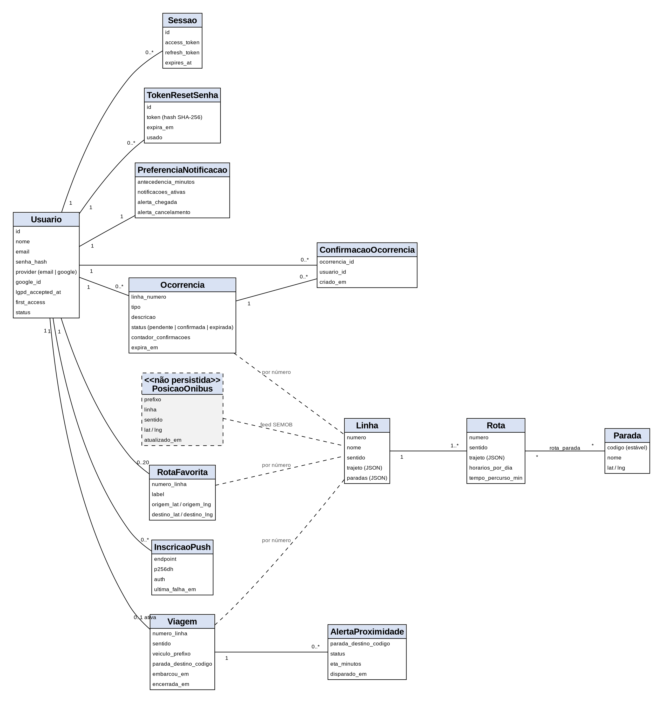
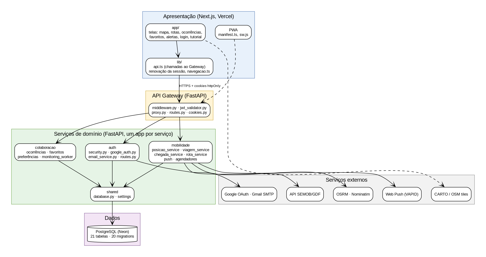
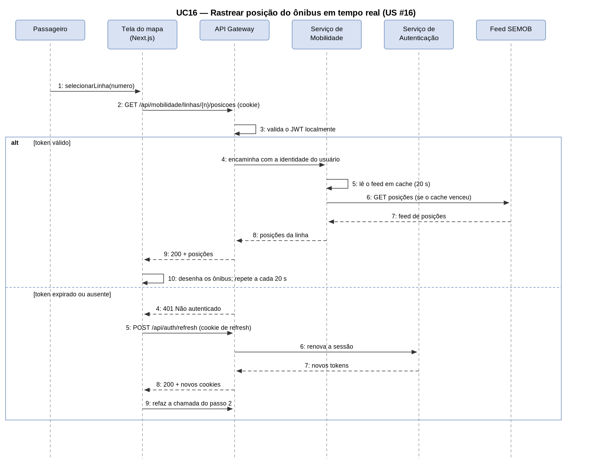
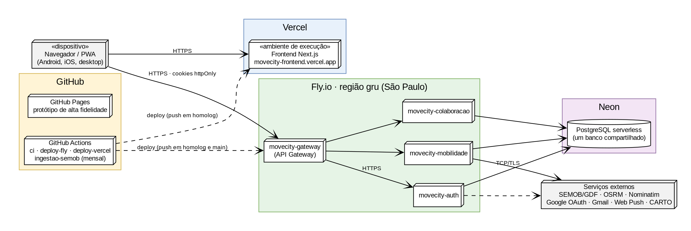
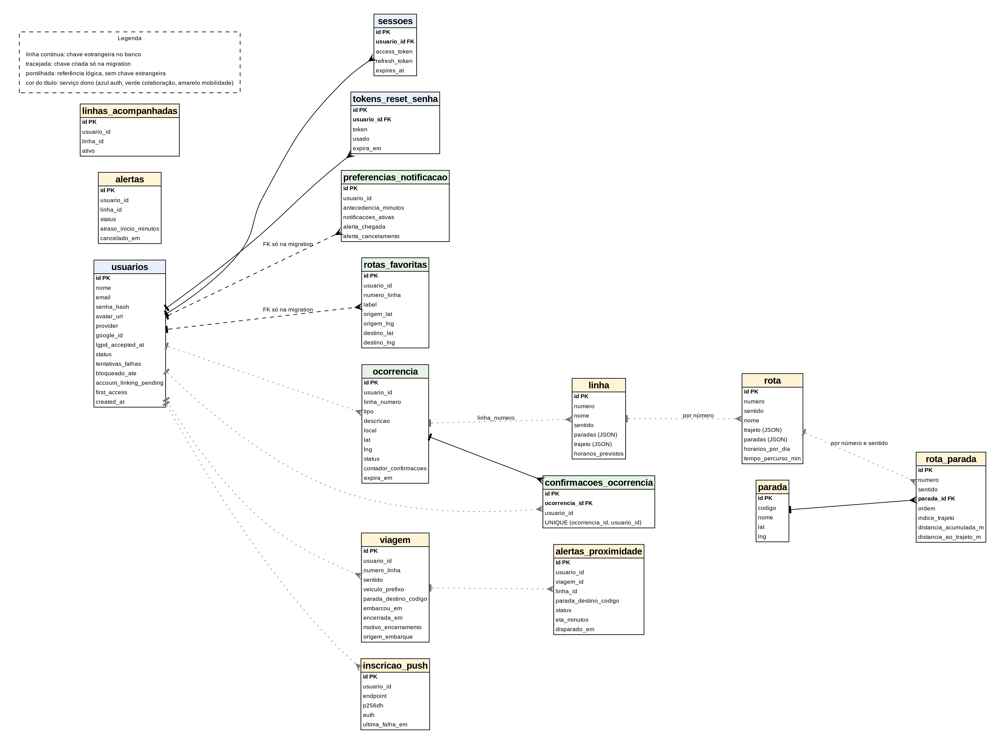

# Documento de Arquitetura de Software — Movecity

**Grupo:** Segurança no Transporte  
**Software:** Movecity  
**Versão:** 3.1

---

## Histórico da Revisão

| Data | Versão | Descrição | Autor |
|---|---|---|---|
| 12/jun/26 | 1.0 | Versão inicial do documento | Grupo Segurança no Transporte |
| 18/set/26 | 2.0 | Atualização pós-implementação: correção das seções divergentes do código (persistência, processos, implementação, implantação e dados) e inclusão da seção 10 — Evolução Arquitetural | Grupo Segurança no Transporte |
| 28/out/26 | 3.0 | Revisão contra o código de `homolog` (ambiente publicado): correção de afirmações que o código contradiz (regiões do Fly, validação cruzada, retenção de ocorrências, worker de colaboração, papel do Gateway na renovação da sessão, acesso ao banco), atualização das tabelas, endpoints, workflows e requisitos não funcionais com o que foi verificado e o que não foi medido, e registro das ADR-16 a ADR-24 | Grupo Segurança no Transporte |
| 30/out/26 | 3.1 | Versão entregue: revisão do texto, remoção de repetições e atualização dos números de testes | Grupo Segurança no Transporte |

---

## Índice Analítico

1. [Introdução](#1-introdução)
   - 1.1 [Finalidade](#11-finalidade)
   - 1.2 [Escopo](#12-escopo)
   - 1.3 [Definições, Acrônimos e Abreviações](#13-definições-acrônimos-e-abreviações)
2. [Restrições e Requisitos Arquiteturais](#2-restrições-e-requisitos-arquiteturais)
3. [Visão de Casos de Uso](#3-visão-de-casos-de-uso)
4. [Visão Lógica](#4-visão-lógica)
   - 4.1 [Representação do Domínio da Aplicação](#41-representação-do-domínio-da-aplicação)
   - 4.2 [Decisões Arquiteturais](#42-decisões-arquiteturais)
   - 4.3 [Representação da Arquitetura Lógica](#43-representação-da-arquitetura-lógica)
   - 4.4 [Representação do Funcionamento da Arquitetura](#44-representação-do-funcionamento-da-arquitetura)
5. [Visão de Processos](#5-visão-de-processos)
6. [Visão da Implementação](#6-visão-da-implementação)
7. [Visão de Implantação](#7-visão-de-implantação)
8. [Visão de Dados](#8-visão-de-dados)
9. [Volume e Desempenho](#9-volume-e-desempenho)
10. [Evolução Arquitetural](#10-evolução-arquitetural-junho-a-outubro-de-2026)
11. [Referências](#11-referências)

---

## 1. Introdução

A introdução deste Documento de Arquitetura de Software apresenta uma visão geral da estrutura e das decisões técnicas adotadas no desenvolvimento do Movecity. Está organizada conforme o modelo "4+1" de Philippe Kruchten (1994), que descreve a arquitetura de software por meio de cinco visões complementares: Lógica, de Processos, de Implementação, de Implantação e de Casos de Uso. Este modelo permite que diferentes públicos — analistas, desenvolvedores, operadores e stakeholders — compreendam o sistema a partir de perspectivas distintas e complementares.

### 1.1 Finalidade

Este documento oferece uma visão geral arquitetural abrangente do sistema Movecity, usando diversas visões arquiteturais para representar diferentes aspectos do sistema. O objetivo é capturar e comunicar as decisões arquiteturais significativas tomadas pelo Grupo Segurança no Transporte durante a especificação do projeto. O público-alvo inclui os desenvolvedores do grupo, o orientador acadêmico e avaliadores da UCB. O documento adota a estrutura "4+1" de Kruchten (1994) como referencial metodológico.

### 1.2 Escopo

O Movecity é um aplicativo web de mobilidade urbana colaborativa voltado para o Distrito Federal, com projeto-piloto nas cidades-satélite de Ceilândia e Taguatinga. A plataforma combina dados GPS oficiais da frota do STPC/DF (via API da SEMOB/GDF) com reportes colaborativos dos próprios passageiros para mitigar o fenômeno do "ônibus fantasma" e reduzir a insegurança nas paradas de ônibus. Este documento descreve a arquitetura de software que suporta essas funcionalidades, **como ela está implementada no ambiente publicado (`homolog`) em 28/10/2026**. Onde o planejamento original (v1.0) divergiu do código, o texto descreve o código e a divergência está registrada na seção 10. O que não foi entregue ou não foi medido aparece como tal, nunca como se existisse.

### 1.3 Definições, Acrônimos e Abreviações

| Termo | Definição |
|---|---|
| **DF** | Distrito Federal |
| **STPC/DF** | Sistema de Transporte Público Coletivo do Distrito Federal |
| **SEMOB** | Secretaria de Mobilidade do GDF |
| **GDF** | Governo do Distrito Federal |
| **API** | Application Programming Interface — interface de comunicação entre sistemas |
| **GPS** | Global Positioning System — sistema de posicionamento global |
| **GeoJSON** | Formato de dados geoespaciais baseado em JSON |
| **SSR** | Server-Side Rendering — renderização do lado do servidor |
| **SSG** | Static Site Generation — geração de site estático |
| **JWT** | JSON Web Token — padrão de autenticação stateless |
| **ORM** | Object-Relational Mapper — mapeador objeto-relacional |
| **CI/CD** | Continuous Integration / Continuous Delivery — integração e entrega contínua |
| **LGPD** | Lei Geral de Proteção de Dados (Lei nº 13.709/2018) |
| **PostGIS** | Extensão geoespacial para PostgreSQL. Avaliada na v1.0 e **não adotada** — ver seção 10 |
| **OSRM** | Open Source Routing Machine — serviço de roteamento sobre a malha viária do OpenStreetMap |
| **CARTO** | Provedor de tiles de mapa usado como base visual do Leaflet |
| **ETA** | Estimated Time of Arrival — tempo estimado de chegada |
| **ADR** | Architecture Decision Record — registro de decisão arquitetural |
| **UC** | Caso de Uso (Use Case) |
| **US** | User Story — história de usuário |
| **MVC** | Model-View-Controller — padrão arquitetural |
| **UCB** | Universidade Católica de Brasília |
| **TCC** | Trabalho de Conclusão de Curso |
| **PWA** | Progressive Web App — aplicativo web instalável, com manifesto e *service worker* |
| **Web Push** | Notificação entregue ao navegador pelo serviço de push do fabricante, mesmo com o app fechado |
| **VAPID** | Voluntary Application Server Identification — par de chaves que identifica o servidor perante os serviços de Web Push |
| **SMTP** | Simple Mail Transfer Protocol — protocolo de envio de e-mail |
| **SameSite** | Atributo de cookie que define se o navegador o envia em requisições entre sites diferentes |

---

## 2. Restrições e Requisitos Arquiteturais

Esta seção descreve os requisitos de negócio e de usuário com impacto sobre os atributos de qualidade da arquitetura, bem como as restrições do projeto. Os atributos de qualidade estão em conformidade com a norma NBR ISO/IEC 25010. A Tabela 1 traz o requisito e a solução arquitetural adotada; a Tabela 1.1 diz, para cada requisito, o que foi de fato verificado e o que **não foi medido**.

| Atributo de Qualidade | Requisito de Arquitetura | Solução |
|---|---|---|
| **Desempenho** | O carregamento inicial do mapa e das posições dos ônibus deve ocorrer em no máximo 3 segundos em conexões 4G. | Posições de GPS lidas ao vivo da origem, com cache em memória de 20 segundos compartilhado entre todos os usuários (seção 5); catálogo de linhas, trajetos e paradas servido do banco, sem consultar a SEMOB a cada busca; trajeto cacheado junto com a linha. |
| **Interoperabilidade** | O sistema deve consumir dados GPS no formato GeoJSON provido pela API oficial da SEMOB/GDF sem necessidade de transformação proprietária. | Backend FastAPI com módulo de ingestão (`semob_source.py`, `ingestao_semob.py`); endpoints RESTful com documentação automática via OpenAPI. |
| **Usabilidade** | A interface deve ser responsiva e acessível para usuários com diferentes níveis de letramento digital, priorizando dispositivos móveis. | Interface em Next.js (App Router) pensada para o celular (folha inferior no mapa), instalável como PWA (`manifest.ts` e `public/sw.js`); componente de mapa via Leaflet JS com interação por toque. |
| **Confiabilidade** | Reportes colaborativos só devem ser confirmados quando validados por outros usuários independentes. | Validação cruzada no serviço de Colaboração: ocorrência de tipo sujeito a validação nasce `pendente` e vira `confirmada` ao receber 3 confirmações de usuários diferentes do autor (`Ocorrencia.LIMITE_CONFIRMACOES`); a restrição de uma confirmação por usuário é garantida por `UNIQUE (ocorrencia_id, usuario_id)` no banco. Acidente e segurança são exibidos de imediato, sem esperar confirmação. Anti-spam: no máximo 3 reportes por usuário por hora (`LIMITE_REPORTES_POR_HORA`). |
| **Segurança** | Dados de geolocalização dos usuários devem ser tratados em conformidade com a LGPD. Sessões autenticadas devem ser gerenciadas de forma segura. | Autenticação por JWT (HS256) enviado em cookies httpOnly; o Gateway valida o token localmente, sem round-trip ao Auth Service; senhas com hash bcrypt; bloqueio da conta por 15 min após 5 senhas erradas; a viagem do passageiro não guarda posição (ADR-15); a query string é omitida do log de acesso do Gateway e da Mobilidade (`shared/logs.py`); a posição do usuário não vai para a URL (ADR-24); HTTPS forçado nos apps do Fly (`force_https = true`) e na Vercel. Limites conhecidos na seção 10.4. |
| **Facilidade de manutenção** | O código deve ser modular e permitir a evolução por serviço sem reestruturação arquitetural. | Separação de responsabilidades por camadas (frontend, gateway, serviços de domínio, dados); serviços independentes, cada um com seu `Dockerfile`, `fly.toml` e `requirements.txt`; testes automatizados executados pelo GitHub Actions a cada PR. O catálogo ingerido cobre o DF inteiro (923 linhas), não só Ceilândia e Taguatinga. |
| **Portabilidade** | O backend deve ser implantável em diferentes provedores de nuvem sem dependência de serviços proprietários. | Imagens Docker (`python:3.12-slim`); banco PostgreSQL padrão (Neon serverless); nenhuma dependência de SDK de nuvem proprietário no código da aplicação. |
| **Escalabilidade** | O sistema deve suportar crescimento de usuários sem redesenho arquitetural, especialmente nos horários de pico (5h–9h e 17h–20h). | Serviços independentes atrás de um Gateway, escaláveis por app no Fly.io; PostgreSQL serverless no Neon; frontend servido pela Vercel. **Limite:** o cache de posições, o limite de tentativas de recuperação de senha e a deduplicação de alertas vivem na memória de cada processo e não são compartilhados entre instâncias; não houve teste de carga. |
| **Disponibilidade** | O sistema deve ter disponibilidade mínima de 99% nos horários de pico definidos. | Cada serviço roda em uma única região (`gru`, São Paulo); o pipeline reprova o deploy se `GET /health` não responder 200 (seção 7). Não há monitoramento contínuo nem alerta de indisponibilidade configurados no repositório, e as máquinas escalam a zero (ADR-12). A meta de 99% **não foi medida**. |

*Tabela 1 – Restrições e requisitos arquiteturais*

### 2.1 Situação dos requisitos

Resultados detalhados no Documento de Testes e Implementação. Aqui fica o que foi verificado e o que **não foi medido**.

| Requisito | O que foi verificado | O que não foi medido |
|---|---|---|
| Desempenho (3 s em 4G) | O cache de 20 s do feed está no código. | Tempo de carregamento do mapa em 4G, latência do Gateway e da SEMOB, partida a frio dos apps do Fly. |
| Precisão do tempo de chegada (ETA) | Lógica coberta por testes automatizados e por casos manuais em produção. | Tolerância do ETA em campo (proposta: 2 min para ETA até 10 min) e a regra "ônibus chegando" (400 m e 2 min) com um ônibus real. |
| Disponibilidade (99% no pico) | Deploys com teste de `/health` no pipeline. | Disponibilidade real: não há série de medição nem monitoramento contínuo. |
| Confiabilidade (validação cruzada) | Regra de 3 confirmações implementada e testada. | Comportamento com muitos usuários reais. |
| Segurança e LGPD | Sessão renovada em produção sem novo login; coordenadas do usuário fora da URL; viagem sem coluna de posição. | Revisão jurídica da LGPD. |
| Usabilidade | Avaliação heurística de Nielsen por um avaliador; teste automatizado de contraste. | Teste com usuários reais; leitor de tela, tamanho de toque e conexão lenta. |
| Manutenção (testes) | 1.640 testes automatizados passando no CI (844 de backend, 796 de frontend); cobertura de 93,7% (backend) e 89,1% (frontend), medida em 16/10. | Cobertura no CI. |
| Integração entre as peças | 49 casos manuais executados em produção: 32 aprovados, 11 aprovados em parte, 1 reprovado por configuração, 3 não verificáveis fora de campo e 2 pendentes. | Teste automatizado de ponta a ponta entre frontend, Gateway e serviços. |
| Escalabilidade | — | Teste de carga. |

*Tabela 1.1 – Situação verificada dos requisitos*

---

## 3. Visão de Casos de Uso

O Movecity foi especificado por meio de histórias de usuário (User Stories), organizadas por épicos funcionais. Cada item está vinculado à sua respectiva issue no GitHub, onde os comentários contêm os artefatos completos de especificação: o protótipo de alta fidelidade (`prototipo-alta-fid/`), diagramas de sequência UML e critérios de aceite BDD.

**Épico: Autenticação e Conta**
- [#11 — Criar Nova Conta de Usuário](https://github.com/davieduardo001/tcc-ciencia-computacao-ucb/issues/11)
- [#10 — Realizar Login com E-mail e Senha](https://github.com/davieduardo001/tcc-ciencia-computacao-ucb/issues/10)
- [#12 — Login via Provedor Social (Google)](https://github.com/davieduardo001/tcc-ciencia-computacao-ucb/issues/12)
- [#13 — Recuperação de Senha (Esqueci minha senha)](https://github.com/davieduardo001/tcc-ciencia-computacao-ucb/issues/13)
- [#31 — Gerenciar Ciclo de Vida da Sessão (logout e renovação de token)](https://github.com/davieduardo001/tcc-ciencia-computacao-ucb/issues/31)

**Épico: Exploração do Mapa**
- [#14 — Visualizar Mapa com Localização Atual](https://github.com/davieduardo001/tcc-ciencia-computacao-ucb/issues/14)
- [#15 — Buscar Linha por Número](https://github.com/davieduardo001/tcc-ciencia-computacao-ucb/issues/15)
- [#16 — Rastrear Posição do Ônibus em Tempo Real](https://github.com/davieduardo001/tcc-ciencia-computacao-ucb/issues/16)
- [#17 — Visualizar Trajeto e Paradas da Linha no Mapa](https://github.com/davieduardo001/tcc-ciencia-computacao-ucb/issues/17)
- [#18 — Ver Detalhes de uma Parada](https://github.com/davieduardo001/tcc-ciencia-computacao-ucb/issues/18)
- [#19 — Ver Tempo Estimado de Chegada do Ônibus até Minha Parada](https://github.com/davieduardo001/tcc-ciencia-computacao-ucb/issues/19)
- [#20 — Calcular Rota de Origem até Destino por Ônibus](https://github.com/davieduardo001/tcc-ciencia-computacao-ucb/issues/20)
- [#21 — Buscar Parada por Nome ou Endereço](https://github.com/davieduardo001/tcc-ciencia-computacao-ucb/issues/21)

**Épico: Colaboração e Reportes**
- [#22 — Receber Notificações de Rotas Preferidas](https://github.com/davieduardo001/tcc-ciencia-computacao-ucb/issues/22)
- [#23 — Reportar Ocorrência em uma Linha](https://github.com/davieduardo001/tcc-ciencia-computacao-ucb/issues/23)
- [#24 — Visualizar Ocorrências Reportadas por Outros Passageiros](https://github.com/davieduardo001/tcc-ciencia-computacao-ucb/issues/24)
- [#25 — Salvar Rota Favorita](https://github.com/davieduardo001/tcc-ciencia-computacao-ucb/issues/25)
- [#26 — Confirmar Ocorrência Reportada por Outro Passageiro](https://github.com/davieduardo001/tcc-ciencia-computacao-ucb/issues/26)
- [#27 — Receber Alerta de Atraso na Linha Acompanhada](https://github.com/davieduardo001/tcc-ciencia-computacao-ucb/issues/27)
- [#29 — Gerenciar Preferências de Notificação](https://github.com/davieduardo001/tcc-ciencia-computacao-ucb/issues/29)

**Épico: Onboarding**
- [#30 — Visualizar Tutorial no Primeiro Acesso](https://github.com/davieduardo001/tcc-ciencia-computacao-ucb/issues/30)

---

## 4. Visão Lógica

Esta seção descreve os componentes significativos da arquitetura do Movecity, sua organização em camadas e pacotes, as principais classes do domínio e as decisões técnicas que definem o design do sistema.

### 4.1 Representação do Domínio da Aplicação

O diagrama de classes da UML é uma representação estática da estrutura do sistema, mostrando as entidades do domínio, seus atributos, operações e os relacionamentos entre elas. Para o Movecity, o diagrama de classes representa as principais entidades de negócio e como elas se relacionam para sustentar as funcionalidades da plataforma.

**Principais entidades do domínio:**



*Figura 1 — Diagrama de classes simplificado do domínio do Movecity*

> Atributos principais, conferidos com os modelos de `homolog`. As tabelas e colunas completas estão na seção 8.

### 4.2 Decisões Arquiteturais

Esta subseção documenta as principais decisões técnicas tomadas para o Movecity, com suas justificativas.

| Item Arquitetural | Decisão | Justificativa |
|---|---|---|
| **Estilo arquitetural** | Microserviços com API Gateway (padrão Gateway API) | Permite escalabilidade independente por serviço, isolamento de falhas e evolução incremental da plataforma sem redesenho total. |
| **Linguagem — Frontend** | TypeScript (v5.x) | Tipagem estática reduz erros em tempo de desenvolvimento; suporte nativo no Next.js e vasto ecossistema. |
| **Framework — Frontend** | Next.js 14.2.5 (React 18, App Router) | Roteamento baseado em arquivos simplifica a estrutura; integração nativa com a Vercel, onde o frontend é publicado. |
| **Linguagem — Backend** | Python 3.12 | Equipe familiarizada com a linguagem; ecossistema maduro para o tratamento dos dados geoespaciais da SEMOB. Na prática, a junção espacial foi implementada com a biblioteca padrão (sem Shapely), o que manteve a imagem Docker enxuta. |
| **Framework — Backend** | FastAPI (>= 0.115) | Framework assíncrono de alto desempenho; documentação automática via OpenAPI 3.0; validação com Pydantic. |
| **Componente de mapa** | Leaflet JS (v1.9) com base CARTO Voyager e recuo automático para o tile padrão do OpenStreetMap | Leaflet é gratuito, open source e suporta GeoJSON nativamente. A base do CARTO tem contraste mais baixo que o tile padrão do OSM, deixando legível o que importa na tela (linha, parada, veículo); passou a exigir chave, que é gratuita (5 milhões de tiles/mês). Sem a chave configurada, o app recua para o tile padrão do OSM — nenhuma tela quebra por falta de credencial. |
| **Formas de persistência** | Banco relacional para o domínio; cache em memória de processo para o feed de posições; cache em tabela para o catálogo de linhas | Três naturezas de dado, três estratégias: entidades do domínio são relacionais; posição de GPS muda a cada poucos segundos e não vale persistir (cache em memória, TTL de 20 s); dados de linha são estáticos e caros de obter (cache na tabela `linha`, populado em lote). |
| **Banco de dados** | PostgreSQL (Neon serverless), **sem PostGIS** | Free tier generoso e escalabilidade automática. A extensão PostGIS foi avaliada na v1.0 e não adotada: as consultas geoespaciais do produto se resumem a uma junção por proximidade entre traçado e abrigos de parada, resolvida em Python com índice de grade na ingestão (seção 10, ADR-02). Geometrias são guardadas em colunas `JSON`. |
| **Serviços de terceiros** | SEMOB/GDF (`dados.semob.df.gov.br`): `/espaciais`, `/horario`, `/pontos` e `/posicao`; OSRM (`router.project-osrm.org`); Nominatim/OpenStreetMap (busca e geocodificação reversa de lugares); Google Routes API (opcional, só com `GOOGLE_MAPS_API_KEY`); CARTO Basemaps; Google OAuth 2.0; Gmail SMTP; serviços de Web Push dos navegadores | Dados oficiais das frotas e da rede, sem chave e sem billing — são os mesmos endpoints que alimentam o app oficial "DF no Ponto". OSRM ajusta o traçado à malha viária real; Nominatim resolve endereços do planejador de rotas. Google OAuth reduz o atrito no cadastro. Gmail SMTP entrega o e-mail de recuperação de senha (ADR-20). Web Push entrega o alerta de proximidade com a tela bloqueada (ADR-16). |
| **Integração com fontes externas** | Padrão *provider*: contrato declarado como `typing.Protocol` em `providers/contratos.py`, com implementação mock e implementação real | Permite desenvolver e testar sem rede e sem cota de API, e trocar a fonte em um único ponto (o service), sem reescrever rota HTTP nem regra de negócio. Foi o que permitiu sair do mock para os dados reais do SEMOB sem tocar no `LinhaService`. |
| **Dependências** | Um `requirements.txt` por serviço, além do combinado na raiz | Cada imagem Docker instala apenas o que o serviço usa, reduzindo o tamanho da imagem. Ver a armadilha correspondente na seção 10 (ADR-08). |
| **Deploy — Backend** | Fly.io — **quatro aplicações independentes** (`movecity-gateway`, `movecity-auth`, `movecity-mobilidade`, `movecity-colaboracao`), cada uma com seu `Dockerfile` e `fly.toml` | Deploy simples via Dockerfile e escala independente por serviço. Separar as aplicações mantém a promessa de isolamento de falhas do estilo de microserviços: a queda de um serviço não derruba os demais. |
| **Deploy — Frontend** | Vercel | Integração nativa com Next.js e deploy automático por push. `homolog` publica em `--prod` no domínio público da Vercel (`movecity-frontend.vercel.app`), usado como ambiente de homologação e para as demonstrações; a `main` não tem deploy próprio de frontend (ADR-19). |
| **CI/CD** | GitHub Actions | Integração nativa com o repositório; pipelines de teste e deploy automatizados sem custo adicional. |
| **Autenticação** | JWT (HS256) em cookies httpOnly — access token de 1 h e refresh token de 7 dias; sessões registradas na tabela `sessoes` | Os cookies httpOnly não são lidos por JavaScript; o Gateway valida o access token localmente, sem round-trip; o refresh token é rotacionado a cada renovação e deixa de valer no logout. A renovação é disparada pelo frontend ao receber 401 (ADR-21). |
| **Notificações** | Web Push com chaves VAPID (`pywebpush`), enviado pelo serviço de Mobilidade | Entrega o aviso de proximidade com o app fechado. Desligado quando as chaves não estão configuradas (ADR-16). |
| **E-mail** | SMTP do Gmail (`smtplib`, porta 587, STARTTLS), enviado pelo serviço de autenticação | Sem dependência nova; usado só na recuperação de senha (ADR-20). |
| **Aplicativo instalável** | PWA: `manifest.ts` e `public/sw.js` | O *service worker* guarda só a casca do aplicativo e recebe os Web Push; dado de transporte nunca é cacheado. |

*Tabela 2 – Decisões arquiteturais*

### 4.3 Representação da Arquitetura Lógica

O diagrama de pacotes da UML representa a organização lógica do sistema em camadas e seus relacionamentos de dependência. O Movecity segue uma arquitetura de microserviços com API Gateway, organizada nas seguintes camadas:



*Figura 2 — Diagrama de pacotes da arquitetura lógica do Movecity*

**Descrição das camadas:**

- **Camada de Apresentação (`<<interface usuario>>`):** Responsável pela interface com o usuário. Implementada em Next.js (React 18, App Router). Contém as páginas, componentes reutilizáveis e o módulo de mapa (Leaflet JS com base CARTO Voyager ou OpenStreetMap). Não contém lógica de negócio — comunica-se exclusivamente com o API Gateway.

- **API Gateway (`<<servico gateway>>`):** Ponto único de entrada para todas as requisições do frontend. Responsável por rotear chamadas aos microserviços corretos, validar o JWT do cookie localmente (sem round-trip ao serviço de autenticação), gravar e limpar os cookies de sessão e encaminhar a identidade do usuário aos serviços de domínio pelo cabeçalho `X-User-Id`, descartando o que o cliente enviar com esse nome (ADR-17). A **renovação do token expirado é feita pelo frontend** (ADR-21): o Gateway apenas faz o proxy de `POST /api/auth/refresh` e regrava os cookies.

- **Serviço de Autenticação (`<<servico autenticacao>>`):** Gerencia o ciclo de vida de usuários e sessões. Emite e valida credenciais; suporta login por e-mail/senha e OAuth 2.0 (Google, com vínculo de conta existente), cadastro com aceite dos termos, renovação e encerramento de sessão, primeiro acesso (tutorial) e recuperação de senha por e-mail.

- **Serviço de Mobilidade (`<<servico mobilidade>>`):** Núcleo funcional da plataforma. Lê as posições de GPS do feed da SEMOB, mantém o catálogo de linhas, paradas e trajetos, calcula rotas de origem a destino (com baldeação) apoiado no OSRM, calcula o tempo de chegada, gerencia a viagem do passageiro (embarcar, trocar o destino, encerrar), o alerta de proximidade da parada e as inscrições de Web Push.

- **Serviço de Colaboração (`<<servico colaboracao>>`):** Gerencia o fluxo de reportes colaborativos (ocorrências), a confirmação por outros passageiros (validação cruzada), as rotas favoritas e as preferências de notificação. O `monitoring_worker` (aviso de rotas preferidas) existe como componente, mas não está agendado em produção (seção 5).

- **Camada de Dados (`<<modelo>>`):** PostgreSQL (Neon) para dados persistentes — usuários, sessões, catálogo de linhas, rotas, paradas, viagens, ocorrências, favoritos e preferências — e a API externa da SEMOB/GDF para as posições de GPS, lidas ao vivo e nunca persistidas. Cada serviço de domínio acessa o banco por si, com a mesma `DATABASE_URL`; o Gateway não acessa o banco.

### 4.4 Representação do Funcionamento da Arquitetura

O diagrama de sequência da UML descreve a colaboração temporal entre os objetos do sistema para um determinado cenário. Ele é fundamental para que os desenvolvedores compreendam como as camadas da arquitetura interagem em tempo de execução, especialmente o papel do API Gateway na validação de sessão e no roteamento de requisições.

O cenário escolhido é o **rastreamento de posição de ônibus em tempo real (UC16)** com token JWT válido, pois demonstra o fluxo completo entre todas as camadas da arquitetura:



*Figura 3 — Diagrama de sequência: UC16 – Rastrear posição do ônibus em tempo real*

> Os diagramas de sequência completos para todos os casos de uso (UC14–UC30) estão disponíveis em `docs/diagramas/sequencia/` no formato PlantUML. Eles descrevem o comportamento **planejado**; onde o código divergiu (por exemplo, a renovação do token), vale este documento e `docs/gateway-auth-flow.md`.

---

## 5. Visão de Processos

O Movecity separa o tratamento dos dados externos segundo a **frequência com que eles mudam**. Dado estático entra em lote e fica no banco; dado volátil é lido ao vivo e nunca é persistido. Essa distinção define os processos descritos a seguir.

**1. Ingestão em lote do catálogo de linhas (fora do ciclo de requisição).** Um job agendado no GitHub Actions (`.github/workflows/ingestao-semob.yml`) baixa os conjuntos `/espaciais` (1.408 trajetos), `/horario` e `/pontos` (7.140 abrigos de parada) da SEMOB — cerca de 37 MB — e popula `linha`, `rota`, `rota_celula`, `parada` e `rota_parada`. O job roda mensalmente (todo dia 1º, às 4h UTC) e sob demanda via `workflow_dispatch`, com limite de 20 minutos; ao final, confere que a tabela `linha` tem mais de 500 linhas. Os números (1.408 trajetos, 923 linhas, 7.140 abrigos) estão registrados nos comentários de `semob_source.py` e em `docs/pesquisa-integracao-onibus-df.md`.

A ingestão faz a **junção espacial** entre o traçado de cada linha e os abrigos de parada, associando o abrigo à linha quando está a até 40 metros do eixo da via (`RAIO_PARADA_METROS`). Para evitar a comparação de todos os traçados contra todos os abrigos, é construído um índice de grade em memória (células de 0,0005 grau, cerca de 55 m); a busca examina apenas as 9 células vizinhas de cada ponto.

> O processamento roda no CI, e não no deploy nem em uma *thread* do FastAPI, por três motivos: são minutos de execução que não devem repetir-se a cada deploy; dado de linha é estático e não justifica polling; e manter isso fora do contêiner evita que o serviço precise de memória para um pico que ocorre uma vez por mês.

**2. Leitura ao vivo das posições da frota (dentro do ciclo de requisição).** O endpoint `/posicao` da SEMOB devolve a frota inteira do DF (~3.500 veículos, segundo o comentário de `posicao_service.py`) em uma única resposta, sem aceitar filtro por linha. O `posicao_service` baixa o feed completo, mantém-no em **cache de processo por 20 segundos** (`CACHE_SEGUNDOS`) e filtra a linha pedida em memória. Como o cache é do feed inteiro, um download atende simultaneamente todos os usuários e todas as linhas — dentro de cada instância do serviço.

Posições com mais de 15 minutos são descartadas como desatualizadas (`IDADE_MAXIMA_MINUTOS`) — um veículo em garagem mantém a última posição registrada por dias. **Nenhuma posição é gravada no banco:** o dado perde validade antes de qualquer consulta posterior justificar o custo de escrita. O frontend renova as posições, as chegadas e a viagem por polling (`setInterval`).

**3. Cache sob demanda do detalhe de linha.** Quando o usuário busca uma linha ainda não cacheada (ou cujo registro está velho), o `LinhaService` consulta o `LinhaProvider` configurado e grava o resultado na tabela `linha`, com `atualizado_em` definindo quando o registro deve ser renovado. O provider é o do Google Maps quando `GOOGLE_MAPS_API_KEY` está configurada e o mock caso contrário (`mobilidade/routes.py`); em 29/10/2026 a chave **não está** nos secrets de `movecity-mobilidade`; em produção o provider é o simulado, que serve só de rede de segurança, e o catálogo de linhas vem da tabela `linha`, populada pela ingestão da SEMOB. Buscas seguintes da mesma linha são servidas do banco, sem tocar a fonte externa.

**4. Alerta de proximidade da parada de destino (serviço de mobilidade).** No `startup`, `mobilidade/main.py` inicia um `BackgroundScheduler` (APScheduler) **dentro do processo** do serviço. O job `monitoramento-proximidade` percorre as viagens ativas no banco, localiza o ônibus da viagem na posição ao vivo, calcula o ETA pelo trajeto até a parada de destino, confere as preferências do usuário (`notificacoes_ativas`, `alerta_chegada`, antecedência) e, ao cruzar o limiar, grava o alerta em `alertas_proximidade` — com índice único por (viagem, parada), de modo que o mesmo aviso não se repete — e chama o notificador. O notificador é o `NotificadorWebPush` quando as três variáveis VAPID existem e são coerentes, e o `NotificadorNulo` caso contrário (ADR-16); o aviso dentro do app independe do push. O intervalo padrão é o de `WORKER_INTERVAL_MINUTES` (5 min), ajustável por `WORKER_PROXIMIDADE_INTERVAL_SECONDS` (mínimo de 20 s). Com 5 minutos, o aviso pode chegar com atraso; a issue #200 prevê medir isso em aparelho e decidir o intervalo — **essa medição não foi feita**.

**5. Rastreamento de atraso (#27) — implementado sobre dados simulados.** O mesmo agendador executa o job `monitoramento-atrasos`, que usa o `ServicoRastreamento` com o `FornecedorGTFSMock` e o `NotificadorNulo`. Não há fonte real de atraso nem canal de entrega: o alerta de atraso fica no servidor e não chega ao usuário.

**6. Monitoramento de rotas preferidas (serviço de colaboração) — componente não agendado.** O `monitoring_worker` expõe apenas `executar_ciclo()` e recebe suas dependências (`FavoritosProvider`, `ETAService`, `PushSender`, `Deduplicador`) por injeção, o que o mantém testável sem relógio, sem rede e sem banco. Porém `colaboracao/main.py` **não tem agendador**: o ciclo só roda quando alguém chama `POST /colaboracao/notificacoes/processar`, rota de demonstração que usa `FavoritosMockProvider`, `ETAMockProvider` e um `PushService` em memória. As rotas favoritas reais (tabela `rotas_favoritas`) não alimentam esse ciclo, e nenhum push chega ao usuário por ele.

**7. Envio de e-mail em segundo plano.** `POST /auth/esqueci-senha` grava o token e agenda o envio com `BackgroundTasks` do FastAPI; a resposta não espera o servidor SMTP (ADR-20).

**Processo de atendimento a requisições.** Cada serviço executa um servidor FastAPI sobre uvicorn. As rotas de proxy do Gateway são assíncronas (`httpx.AsyncClient`, timeout de 30 s, 504 em timeout e 502 se o serviço não conecta); as demais rotas dos serviços são em sua maioria síncronas e rodam no pool de *threads* do FastAPI. A comunicação entre os serviços é sempre HTTP, via Gateway; o código não contém chamadas diretas entre serviços de domínio nem fila de mensagens.

---

## 6. Visão da Implementação

O código-fonte do Movecity está organizado nos seguintes módulos principais:

**Frontend (`/src/frontend/`):**
- `app/` — Páginas, layouts e componentes de tela (Next.js App Router). Cada rota concentra seus próprios componentes: `app/mapa/` reúne `AppShell`, `MapaInterativo`, `PlanejadorViagem` e os componentes da viagem; as demais rotas são `login`, `cadastro`, `recuperar-senha`, `redefinir-senha`, `tutorial`, `ocorrencias`, `favoritos`, `alertas`, `configuracoes` e `status`.
- `app/globals.css` — Fundação visual: *design tokens* da identidade, tipografia e estilos de base compartilhados por todas as telas.
- `app/manifest.ts` e `public/sw.js` — Manifesto do PWA e *service worker* (casca do app e recebimento de Web Push).
- `lib/` — `api.ts` (cliente HTTP do Gateway, incluindo `fetchAutenticado`, que renova a sessão em 401), `push.ts` (inscrição de Web Push), `rotaPendente.ts` (rota repassada entre telas sem passar pela URL) e `navegacao.ts`.
- `public/` — Assets estáticos (logotipo, ícones e `sw.js`).
- `__tests__/` — Testes de componente (Jest + Testing Library), colocados ao lado do código que testam.

**Backend (`/src/backend/`):** cada serviço é um pacote autocontido e segue a mesma anatomia interna — `main.py` (aplicação FastAPI), `routes.py` (endpoints), `schemas.py` (contratos Pydantic), `models/` (entidades SQLAlchemy), `providers/` (integrações externas por trás de um `Protocol`, onde existem) e `tests/`.

- `gateway/` — API Gateway: `middleware.py`, `jwt_validator.py`, `dependencies.py`, `proxy.py`, `cookies.py`, `config.py`, `routes.py`.
- `auth/` — Autenticação: `security.py` (hash bcrypt e JWT), `google_auth.py` (OAuth 2.0), `email_service.py` (e-mail de recuperação de senha por SMTP) e os modelos `Usuario`, `Sessao` e `TokenResetSenha`.
- `mobilidade/` — Mobilidade: `linha_service.py`, `rota_service.py`, `posicao_service.py`, `eta_service.py`, `chegada_service.py`, `geocode_service.py`, `parada_service.py`, `busca_parada_service.py`, `viagem_service.py` e `viagem_routes.py`, `web_push.py` e `push_routes.py`, `semob_source.py`, `ingestao_semob.py`, `workers/monitoramento.py`, `services/` (rastreamento, proximidade, notificações) e os providers (`linha_mock`, `linha_google_maps`, `osrm_router`, `polyline_decoder`, `gtfs_mock`, `veiculos_ao_vivo`, `viagens_ativas_banco`, `preferencias_banco`, entre outros).
- `colaboracao/` — Colaboração: `routes.py` (ocorrências, confirmações, favoritos e preferências de notificação), `monitoring_worker.py`, `eta_service.py`, `push_service.py`, `deduplicador.py` e os providers `eta_mock` e `favoritos_mock`.
- `shared/` — Configuração (`config.py`), sessão de banco (`database.py`) e filtro de log (`logs.py`) compartilhados entre os serviços.
- `models/base.py` — `Base` declarativa do SQLAlchemy, comum a todos os modelos.
- `alembic/` — Migrations versionadas; um único encadeamento (20 revisões em `homolog`) para todo o banco, mesmo com os serviços separados.

> **Nota de estrutura:** não existe pacote `core/`, e o pacote `models/` da raiz contém apenas a `Base` declarativa — os modelos de cada domínio vivem dentro do próprio serviço. A v1.0 deste documento antecipava uma estrutura que a implementação não seguiu.

---

## 7. Visão de Implantação

O Movecity é implantado em infraestrutura de nuvem, com cada componente em seu ambiente adequado:



*Figura 4 — Diagrama de implantação do Movecity*

**Nós físicos/lógicos:**

| Nó | O que executa | Observações |
|---|---|---|
| **Vercel** | Frontend Next.js | Publicado em `movecity-frontend.vercel.app`. O deploy dispara no push para `homolog`, em modo `--prod`: nesta fase, `homolog` **é** o ambiente público, usado para homologação e demonstrações. `main` não tem deploy próprio de frontend (ADR-19). |
| **Fly.io — `movecity-gateway`** | API Gateway (FastAPI) | Região primária `gru` (São Paulo), uma única região. Único serviço que o navegador acessa diretamente (via frontend). Não acessa o banco. |
| **Fly.io — `movecity-auth`** | Serviço de autenticação | Acessa o banco. Recebe `GOOGLE_CLIENT_ID`, `SMTP_USER`, `SMTP_PASSWORD`, `SMTP_FROM` e `FRONTEND_URL` como secrets no deploy (os de SMTP só são aplicados se os quatro existirem). |
| **Fly.io — `movecity-mobilidade`** | Serviço de mobilidade | Acessa o banco e as APIs externas (SEMOB, OSRM, Nominatim). Recebe `VAPID_PUBLIC_KEY`, `VAPID_PRIVATE_KEY` e `VAPID_SUBJECT` no deploy se existirem; `RAIO_EMBARQUE_M` é secret do app (ADR-23). Executa o agendador do alerta de proximidade. |
| **Fly.io — `movecity-colaboracao`** | Serviço de colaboração | Acessa o banco. |
| **Neon (PaaS gerenciado)** | PostgreSQL serverless | Um único projeto/banco compartilhado pelos serviços e por homologação e produção (ADR-19). Sem PostGIS. Política de backup e *failover* dependem do plano do Neon e não foram verificadas neste levantamento. |
| **GitHub Pages** | Protótipo de alta fidelidade (`prototipo-alta-fid/web`) | Publicado pelo workflow `deploy-pages.yml` em push na `main`. Não faz parte do produto em execução. |
| **SEMOB/GDF, OSRM, Nominatim, CARTO, Google, Gmail, serviços de Web Push** | Serviços externos | Não gerenciados pelo Movecity. Cada um tem uma degradação prevista quando indisponível (seção 10.3). |

*Tabela 3 – Nós de implantação*

Todos os apps do Fly têm `internal_port = 8000`, `force_https = true`, `auto_stop_machines = true`, `auto_start_machines = true` e `min_machines_running = 0`. Não há seção `[checks]` nos `fly.toml`: a verificação de saúde é o *smoke test* do pipeline.

**Pipeline de implantação (GitHub Actions, `deploy-fly.yml` e `deploy-vercel.yml`):**

```
push em homolog ou main (src/backend/**)
        │
        ▼
   [migrate]  alembic upgrade head   ← roda uma vez, antes de tudo
        │
        ├──► [deploy-auth]         ──► secrets (Google, SMTP) ──► deploy ──► smoke test GET /health
        ├──► [deploy-mobilidade]   ──► secrets (VAPID)        ──► deploy ──► smoke test GET /health   (em paralelo)
        └──► [deploy-colaboracao]  ──►                            deploy ──► smoke test GET /health

   [deploy-gateway] ──► deploy ──► smoke test GET /health   (independente: não usa banco)

push em homolog (src/frontend/**)
        │
        ▼
   [deploy-homolog]  vercel pull --environment=production → vercel build --prod  →  vercel deploy --prebuilt --prod
```

Cada `deploy-*` tem seu próprio grupo de concorrência, com `cancel-in-progress: false`: dois merges seguidos enfileiram, em vez de um cancelar o deploy do outro pela metade. O **smoke test** consulta `GET /health` do serviço recém-publicado por até 10 tentativas com 5 segundos de intervalo, e falha o job se nenhuma retornar 200 — um contêiner que sobe e morre no boot reprova o deploy em vez de passar despercebido. Os passos de secrets são "aplicar só se existirem": sem os secrets do SMTP ou do VAPID, o deploy conclui e o recurso fica desligado.

**Escala a zero.** Sem tráfego, o serviço desliga, o que mantém o custo do projeto-piloto próximo de zero, ao preço de uma latência de partida a frio na primeira requisição após um período ocioso — aceitável em avaliação acadêmica, mas incompatível com a meta de 3 segundos da seção 2 se o produto for a público. Essa latência **não foi medida**. Uma consequência adicional: o agendador do alerta de proximidade roda dentro do processo da Mobilidade; com a máquina desligada por ociosidade, ele pode não executar. A mitigação (manter uma máquina viva por serviço) é uma mudança de configuração, não de arquitetura.

**Outros fluxos automatizados:**

| Workflow | Gatilho | Função |
|---|---|---|
| `ci.yml` | Todo PR para `homolog` ou `main` e disparo manual (não roda em push) | Quatro jobs: testes de backend (pytest, com migrations, contra um serviço PostgreSQL 16 — a imagem usada é a `postgis/postgis`, mas nenhuma extensão é usada); verificação de cada serviço em um ambiente limpo, só com o `requirements.txt` dele, importando a aplicação (ADR-08); testes de frontend (Jest, Node 20); e validação de Conventional Commits no título do PR e nos commits. Não há lint de frontend nem medição de cobertura. |
| `deploy-fly.yml` | Push em `homolog` ou `main` que altere `src/backend/**`, e manual | Migrations, deploy dos quatro apps e *smoke test*. |
| `deploy-vercel.yml` | Push em `homolog` que altere `src/frontend/**`, e manual | Build e deploy de produção do frontend na Vercel. |
| `deploy-pages.yml` | Push em `main` que altere `prototipo-alta-fid/web/**`, e manual | Publica o protótipo no GitHub Pages. |
| `ingestao-semob.yml` | Mensal (dia 1º, 4h UTC) e manual | Baixa os dados da SEMOB e popula as tabelas do catálogo, conferindo ao final que vieram centenas de linhas. |

---

## 8. Visão de Dados

O Movecity persiste dados estruturados no PostgreSQL. A seguir, a descrição das entidades principais e seus relacionamentos.

**Minimundo:** Um `Usuario` pode ter várias `Sessao` ativas, um conjunto de `PreferenciaNotificacao` e múltiplas `RotaFavorita`. Uma `Linha` guarda o próprio trajeto e a lista de paradas; a `Rota` (linha × sentido) liga-se às `Parada` físicas por `RotaParada`. Um `Usuario` autenticado pode criar `Ocorrencia` vinculada ao **número** de uma linha, e outros usuários podem confirmá-la (`ConfirmacaoOcorrencia`), incrementando seu contador — regra da validação cruzada (3 confirmações de usuários diferentes do autor). Um `Usuario` pode ter uma `Viagem` ativa por vez, com `AlertaProximidade` e `InscricaoPush` próprios.

**Tabelas implementadas (migrations de `homolog`):**

| Tabela | Conteúdo | Origem |
|---|---|---|
| `usuarios` | Conta do usuário: nome, e-mail, hash de senha, `provider`, `google_id`, `avatar_url`, aceite da LGPD, `first_access`, tentativas falhas e bloqueio, vínculo pendente com Google | US #10–13, #30, #92 |
| `sessoes` | Sessões emitidas (access e refresh token), para revogação e renovação | US #10, #31, #212 |
| `tokens_reset_senha` | Tokens de uso único (guardados como hash SHA-256, validade de 60 min) para recuperação de senha | US #13 |
| `linha` | Catálogo de linhas: número, nome, sentido, `paradas`, `trajeto` e `horarios_previstos` | US #15, #17 |
| `rota` / `rota_celula` | Trajeto por linha × sentido, horários por dia da semana, tempo de percurso e o índice de grade que acelera a busca por proximidade | US #20, #173 |
| `parada` / `rota_parada` | Parada física única (código estável) e a posição dela em cada rota: ordem, índice no trajeto, distância acumulada e distância ao traçado | US #173 |
| `viagem` | Viagem do passageiro, sem coluna de posição; uma ativa por usuário (índice único parcial) | US #171 |
| `alertas_proximidade` | Aviso de proximidade disparado por viagem e parada (índice único) | US #172 |
| `inscricao_push` | Inscrição de Web Push do aparelho: endpoint, chaves públicas do navegador, data da última falha; sem coordenadas, nome ou *user agent* | US #195 |
| `ocorrencia` | Reporte de ocorrência: número da linha, tipo, descrição, local, `lat`/`lng` opcionais, status, contador de confirmações e `expira_em` | US #23, #24 |
| `confirmacoes_ocorrencia` | Confirmação por outro usuário; `UNIQUE (ocorrencia_id, usuario_id)` | US #26 |
| `rotas_favoritas` | Rota salva: linha, rótulo e coordenadas de origem e destino; limite de 20 por usuário | US #25 |
| `preferencias_notificacao` | Antecedência do aviso e chaves de ativação por tipo de alerta, uma linha por usuário | US #29 |
| `alertas` / `linhas_acompanhadas` | Alerta de atraso e linhas acompanhadas, usados pelo rastreamento sobre dados simulados | US #27 |
| `test_user`, `test_linha`, `test_log`, `test_reporte` | Tabelas de teste criadas na migration inicial; sem função no produto | — |

*Tabela 4 – Tabelas persistidas*

**Entidades não persistidas.** `PosicaoOnibus` **não é persistida por decisão de projeto**: a posição é lida ao vivo e descartada (seção 5, processo 2). A `Parada` tem tabela própria desde a US #173; `linha.paradas` segue como JSON só para a exibição da linha.

**Integridade referencial entre serviços.** Dentro de um serviço, as chaves estrangeiras existem (por exemplo `sessoes.usuario_id` e `tokens_reset_senha.usuario_id` para `usuarios`, `confirmacoes_ocorrencia.ocorrencia_id` para `ocorrencia`, `rota_parada.parada_id` para `parada`). Entre serviços, o ORM **não declara** a chave para `usuarios` (`ocorrencia`, `rotas_favoritas`, `preferencias_notificacao`, `viagem`); nos casos de `rotas_favoritas` e `preferencias_notificacao` a migration cria a chave no banco (ADR-22). `ocorrencia.linha_numero` e `viagem.parada_destino_codigo` não têm chave estrangeira por desenho.

**Representação de geometria.** Trajetos e paradas são armazenados em colunas `JSON` — `list[[lat, lng]]` para o traçado e `list[{nome, lat, lng}]` para as paradas —, e não em tipos geoespaciais. O consumidor desses dados é o Leaflet no navegador, que recebe coordenadas em JSON de qualquer forma; guardá-las no formato final evita conversão a cada leitura. A única operação genuinamente espacial do sistema — associar abrigos de parada ao traçado de uma linha — ocorre uma vez por mês, na ingestão, e é resolvida em Python com índice de grade (seção 10, ADR-02). Coordenadas de ocorrências e de favoritos são pares `Float` (`lat`/`lng`), sem tipo geoespacial.

**Dados de localização que o banco guarda.** A posição de GPS do usuário **não** é gravada (a viagem não tem coluna de posição, ADR-15). O banco guarda, porém, coordenadas que o usuário escolhe informar: o `lat`/`lng` opcional de uma ocorrência e a origem e o destino de uma rota favorita.

**Modelo Entidade-Relacionamento (MER):**



*Figura 5 — Modelo entidade-relacionamento (MER) das tabelas implementadas em `homolog`*

> As coordenadas seguem o sistema de referência WGS84 (o mesmo do GeoJSON da SEMOB/GDF e do Leaflet), porém guardadas como pares numéricos em colunas `JSON`, sem tipo geoespacial nem índice espacial no banco.

---

## 9. Volume e Desempenho

Esta seção separa o que é **premissa de dimensionamento** (nunca medida) do que é **fato verificado** no código ou nos dados.

**Premissas do projeto-piloto (Ceilândia e Taguatinga) — não medidas, sem teste de carga:**

| Métrica | Valor assumido |
|---|---|
| **Usuários cadastrados (fase piloto)** | 5.000 |
| **Usuários simultâneos (média)** | 500 |
| **Pico de usuários simultâneos** (horários de pico) | 1.500 |
| **Requisições por segundo** (pico) | 150 req/s |
| **Disponibilidade mínima** | 99% nos horários de pico (5h–9h e 17h–20h) |
| **Tempo de carregamento inicial** | ≤ 3 segundos em conexão 4G |

**Fatos verificados:**

| Item | Valor | Fonte |
|---|---|---|
| Linhas no catálogo (ingestão SEMOB) | 923 linhas / 1.408 trajetos | `semob_source.py` |
| Abrigos de parada no catálogo | 7.140 | `semob_source.py` |
| Volume baixado por ingestão | ~37 MB | `ingestao-semob.yml` |
| Atualização do feed de GPS | Leitura ao vivo, cache de 20 s por instância; posição com mais de 15 min é descartada | `posicao_service.py` |
| Retenção de posições GPS | Não persistidas | ADR-04 |
| Retenção de ocorrências | O registro **não é apagado**; o `expira_em` (15 a 120 min, conforme o tipo) só o tira da listagem | `colaboracao/models/ocorrencia.py` |
| Validade da sessão | Access token de 1 h; refresh token de 7 dias | `gateway/cookies.py`, `auth/security.py` |
| Validade do link de recuperação de senha | 60 minutos, uso único | `auth/models/token_reset_senha.py` |
| Duração máxima de uma viagem | 4 h (depois expira) | `viagem_service.py` |
| Backup | Não verificado (depende do plano do Neon) | — |

> **Ressalva sobre as estimativas de volume.** Os números de crescimento de dados foram projetados na v1.0 supondo um histórico de posições de GPS em banco. Com a ADR-04 (posição lida ao vivo e não persistida), o crescimento real do banco é governado pelo catálogo de linhas — estático — e pelas tabelas de usuário, o que o torna substancialmente menor que o projetado. As metas de desempenho e disponibilidade seguem como metas, **não como resultados**: nem o tempo de carregamento, nem a disponibilidade, nem a capacidade foram medidos, e a ADR-12 registra o risco da partida a frio.

---

## 10. Evolução Arquitetural (junho a outubro de 2026)

Esta seção registra as decisões arquiteturais tomadas **durante a implementação**, entre a versão 1.0 deste documento (12/jun/26) e 28/out/26. Cada registro segue o formato ADR (*Architecture Decision Record*): a decisão, o que a motivou e a consequência assumida. Onde a decisão contraria a v1.0, isso está dito explicitamente. As ADR-01 a ADR-15 foram registradas na v2.0 e conferidas contra o código na v3.0; as ADR-16 a ADR-24 são da v3.0.

### 10.1 Registro de decisões (ADR-01 a ADR-15)

| ID | Decisão | Motivação | Consequência assumida |
|---|---|---|---|
| **ADR-01** | O Gateway alcança os serviços pelas **URLs públicas HTTPS** (`movecity-*.fly.dev`), e não pela rede privada `.internal` do Fly.io. | A rede privada do Fly é IPv6-only. Para usá-la, os serviços precisariam de bind dual-stack, o que causou instabilidade com o proxy público do próprio Fly. | Os serviços ficam acessíveis pelas URLs públicas; o Gateway é o único ponto que o frontend chama. |
| **ADR-02** | **PostGIS não foi adotado.** Geometrias ficam em colunas `JSON`; a única junção espacial é resolvida em Python com índice de grade (células de ~55 m, raio de busca de 40 m). | O produto tem uma só operação espacial de verdade — associar abrigos de parada ao traçado da linha — e ela roda uma vez por mês, na ingestão. Adotar PostGIS acrescentaria uma extensão, um tipo de coluna e um vocabulário de consulta para atender a um caso único e offline. | **Contraria a v1.0**, que previa PostGIS em várias seções. Se surgir busca por raio em tempo de requisição (ex.: "paradas perto de mim" no servidor), a decisão deve ser reavaliada — hoje esse cálculo acontece no navegador. |
| **ADR-03** | Os dados da SEMOB são **copiados para o banco** por ingestão em lote, em vez de consultados a cada busca. | Os endpoints não aceitam filtro: devolvem sempre o payload inteiro (~37 MB somados). Consultar por usuário seria inviável. Além disso, são endpoints públicos sem documentação nem SLA publicados. | Se a SEMOB sair do ar, a busca continua funcionando com o último snapshot. Em troca, o catálogo pode ficar até um mês desatualizado — aceitável para dado que muda raramente. |
| **ADR-04** | Posições de GPS são **lidas ao vivo com cache de 20 s e nunca persistidas**. | O feed traz a frota inteira do DF em uma resposta só; um download serve todos os usuários simultaneamente. Posição perde validade em segundos. | **Contraria a v1.0**, que previa persistir posições a cada 30 s com retenção de 24 h. Não há histórico de posições — se análises retrospectivas entrarem no escopo, será preciso um processo de arquivamento à parte. |
| **ADR-05** | O traçado exibido no mapa passa pelo **OSRM**, e não pela linha reta entre paradas. | A geometria bruta ligava paradas em linha reta, atravessando quadras. O OSRM ajusta o traçado à malha viária real do OpenStreetMap. | Mais uma dependência externa no caminho do usuário. O trajeto é cacheado junto com a linha, então a chamada não se repete a cada visualização. |
| **ADR-06** | Integrações externas ficam atrás de um **contrato `typing.Protocol`**, com implementação mock e implementação real. | Permite desenvolver e testar sem rede e sem cota de API, e trocar a fonte em um ponto só. | Foi o que permitiu migrar do mock para os dados reais do SEMOB sem reescrever `LinhaService`, rota HTTP nem teste. Custo: uma camada de indireção a mais em cada integração. |
| **ADR-07** | Cookies de sessão usam **`SameSite=None` com `Secure`**, e não `Lax`/`Strict`. | Frontend (Vercel) e Gateway (Fly) estão em domínios diferentes — é cross-site de fato. Com `Lax`/`Strict`, o navegador não envia o cookie em `fetch()` cross-site, e toda chamada autenticada caía em 401 logo após um login bem-sucedido. | **Corrige a v1.0**, cuja tabela de cookies indicava `Lax`/`Strict`. `SameSite=None` amplia a exposição a CSRF; a mitigação atual é o escopo restrito de `path` por cookie e a obrigatoriedade de HTTPS. Unificar frontend e Gateway sob um mesmo domínio permitiria voltar a `Lax`. |
| **ADR-08** | Cada serviço tem seu **próprio `requirements.txt`**, além do combinado na raiz. | Cada imagem Docker instala só o que o serviço usa, reduzindo o tamanho da imagem e o tempo de build. | Criou uma armadilha real: o CI instala o combinado da raiz, e o contêiner instala o do serviço. Dependência ausente no arquivo do serviço **passa no CI e derruba o contêiner no boot**. Aconteceu duas vezes (PR #102, no mobilidade; PR #127/#128, no colaboração). O smoke test em `/health` no pipeline existe justamente para transformar esse erro em deploy reprovado. |
| **ADR-09** | O `CORSMiddleware` é o **middleware mais externo** da pilha do Gateway. | O Starlette executa primeiro o último middleware adicionado. Com o CORS abaixo do middleware de autenticação, o preflight `OPTIONS` — que nunca carrega cookie — era barrado com 401 antes de o CORS responder. | Todo 401 legítimo passa a chegar ao frontend como 401, e não como "bloqueado por CORS". A ordem virou regra verificada por teste (`test_cors_ordem_middleware.py`). |
| **ADR-10** | As **migrations rodam no pipeline**, em um job único que antecede os deploys dos serviços. | Com quatro serviços e um banco só, deixar cada contêiner migrar no boot causaria corrida entre eles. | Um encadeamento único do Alembic para todo o banco, mesmo com os serviços separados — o que exige atenção ao `down_revision` quando duas USs criam migration em paralelo (aconteceu na US #29). |
| **ADR-11** | A base do mapa é o **CARTO Voyager**, com recuo automático para o tile padrão do OpenStreetMap. | O tile padrão do OSM é denso e saturado, e disputa atenção com o que importa na tela. A base do CARTO tem contraste menor e deixa legíveis linha, parada e veículo. | A CARTO passou a exigir chave. A chave é gratuita (5 milhões de tiles/mês), mas virou uma variável de ambiente a mais. Sem ela, o mapa recua para o OSM e continua funcionando — nenhuma tela quebra por falta de credencial. |
| **ADR-12** | As máquinas do Fly operam com **escala a zero** (`min_machines_running = 0`). | Mantém o custo do projeto-piloto próximo de zero. | Partida a frio na primeira requisição após ociosidade. Conflita com a meta de 3 segundos da seção 2 em um cenário real de produção; a correção é configuração, não arquitetura. |
| **ADR-13** | O proxy do Gateway repassa a **query string** e **não repassa o `Accept-Encoding`** do cliente. | Descartar a query string quebrava toda rota com parâmetro. Repassar o `Accept-Encoding` fazia o serviço de destino devolver corpo comprimido que o proxy entregava sem descomprimir. | O proxy deixou de ser transparente por acidente e passou a ser transparente por contrato, com teste cobrindo os dois comportamentos. |
| **ADR-14** | A **parada física tem tabela própria** (`parada`), criada por fusão de abrigos a até 10 m na ingestão, com código derivado do centróide e desempate de colisão. | O `/pontos` do SEMOB não tem identificador e repete o mesmo abrigo em registros vizinhos (~900 pares a até 15 m). O código derivado da coordenada clicada mudava conforme o registro, e o ETA não conseguia relacionar parada, veículo e sentido. | A tabela é reconstruída a cada ingestão, então o `id` muda; **quem consome deve usar o `codigo`**. O espaço de 100 mil códigos colide (113 de 4.318 paradas), por isso há sondagem determinística. Dois abrigos de lados opostos da rua (> 10 m) continuam separados. Fusão a 10 m junta sentidos exclusivos opostos em 1 caso de 307 medidos. |
| **ADR-15** | A **viagem do passageiro é persistida** (`viagem`), mas **sem nenhuma coluna de posição**: guarda usuário, linha, sentido, prefixo do veículo, parada de destino e os horários de embarque e encerramento. O embarque é confirmado no servidor por proximidade (veículo da linha a até 100 m, posição de até 5 min) e a posição do usuário enviada para isso é descartada. O progresso (próxima parada, paradas restantes) é calculado na leitura, a partir da posição ao vivo do veículo. | O produto precisa saber que alguém está a bordo (para esconder a espera e disparar o alerta de proximidade da #172), mas a LGPD e a ADR-04 vedam trilha de posição. Inferir o embarque por GPS contínuo exigiria rastrear a pessoa o tempo todo. | Uma viagem ativa por usuário, garantida por **índice único parcial** no banco (não só na aplicação). Viagem esquecida expira em 4 h. A tabela guarda `parada_destino_codigo` **sem chave estrangeira**, porque `parada` é reconstruída a cada ingestão (ADR-14); destino que sumiu simplesmente deixa a viagem fora do alerta. O raio padrão de 100 m passou a ser configurável por variável de ambiente e a ter uma segunda regra de embarque (ADR-23); calibrá-lo em campo continua pendente: com o feed atualizando a cada 20 s, um ônibus em movimento já andou ~220 m entre duas leituras. |

*Tabela 5 – Registro de decisões arquiteturais*

### 10.2 Decisões da Sprint 3 e da Sprint 4 (ADR-16 a ADR-24)

| ID | Decisão | Motivo | Consequência |
|---|---|---|---|
| **ADR-16** | **Web Push com chaves VAPID** para o alerta de proximidade, enviado pelo serviço de Mobilidade (`pywebpush`). A inscrição do aparelho fica na tabela `inscricao_push`, sem coordenadas, nome nem *user agent*; o dono vem do `X-User-Id`, nunca do corpo; só são aceitos endpoints `https` de FCM, Mozilla, Apple e Windows (proteção contra SSRF). Sem as três variáveis VAPID, o notificador é nulo e o controle aparece como indisponível. | O alerta só aparecia dentro do app; quem está com a tela bloqueada não era avisado (#195). | O push cobre o alerta de proximidade; o aviso dentro do app independe dele. As chaves valem para homologação e produção (ADR-19), e trocá-las invalida as inscrições. O ciclo do worker (padrão de 5 min) pode atrasar o aviso. |
| **ADR-17** | **O Gateway descarta o `X-User-Id` enviado pelo cliente** (sem diferenciar maiúsculas, mesmo em rota pública) e repassa só a identidade extraída do JWT. | O cabeçalho do cliente também chegava ao serviço (#188). | A identidade que o serviço lê é sempre a do Gateway; o contrato é coberto por testes do Gateway. |
| **ADR-19** | **Homologação e produção não são separadas.** O mesmo pipeline publica os quatro apps do Fly em push para `homolog` ou `main`, há um único banco Neon, e o frontend publica só a partir de `homolog`, em modo `--prod`. | Custo: a separação foi retirada do escopo pelo grupo (#42, fechada em 14/10). | `homolog` é o ambiente visível ao usuário: um merge muda o que as pessoas veem, as migrations rodam no banco compartilhado e as variáveis de ambiente valem para os dois lados. |
| **ADR-20** | **E-mail de recuperação de senha por SMTP** (Gmail, porta 587, STARTTLS), com `smtplib`, em segundo plano (`BackgroundTasks`). O token vale 60 min, é de uso único e guardado como hash SHA-256; a resposta é a mesma para e-mail cadastrado e não cadastrado; limite de 5 solicitações por e-mail em 15 min. **Não há confirmação de conta por e-mail.** | O envio era só um esboço que registrava o link no log, e a recuperação (#13, #133) nunca entregava o e-mail. | Depende de uma conta Gmail; falha de SMTP é registrada e não derruba o endpoint. O limite de solicitações vive na memória do processo. |
| **ADR-21** | **Rota `POST /auth/refresh` e renovação pelo frontend.** O Auth valida o refresh token, confere a sessão, **rotaciona** o par de tokens e responde; o Gateway regrava os cookies. No frontend, `fetchAutenticado` renova **uma única vez** ao receber 401 e repete a requisição; renovações concorrentes compartilham a mesma promessa. Se falha, leva a `/login?sessao=expirada`. | O Gateway fazia proxy do refresh, mas o Auth não tinha a rota (#212), e o frontend tratava o 401 como "sem dados" (#221). | A renovação é reativa, não agendada, e o Gateway só valida o access token e faz proxy do refresh. |
| **ADR-22** | **A chave estrangeira para `usuarios` sai do ORM de Colaboração** e fica no banco, pela migration. Um teste de regressão carrega só os modelos de Colaboração. | O modelo `Usuario` pertence ao Auth e não existe no contêiner de Colaboração; sem ele, `GET /colaboracao/preferencias/{id}` respondia 500 (#213). | O banco garante a integridade; o `autogenerate` do Alembic pode propor remover essas chaves e não deve ser usado para "corrigir" a diferença. |
| **ADR-23** | **Regra de embarque configurável:** `RAIO_EMBARQUE_M` (padrão 100 m) e a regra do "ônibus chegando" (usuário a até 400 m de uma parada da linha e ônibus a até 2 min dela). A posição do usuário só valida o embarque e é descartada (ADR-15); a do veículo tem no máximo 5 min. | Quem estava na parada com o ônibus chegando era recusado (#190). | **Em produção o raio está em 100 km, por decisão do grupo, só para demonstrar o "Peguei este ônibus" na defesa; a regra de uso real é 100 m.** Os limiares não foram validados em campo. |
| **ADR-24** | **A posição do usuário não vai para a URL:** a rota pendente passa por `sessionStorage` (chave `movecity:rota-pendente`), apagada na primeira leitura. | As coordenadas do botão "Ir" iam para o histórico, links copiados e logs (#231), contrariando a LGPD. | A rota não sobrevive à aba nem se compartilha por link. O filtro `shared/logs.py` já omitia a query string do log. |

*Tabela 5.1 – Decisões da Sprint 3 e da Sprint 4*

### 10.3 Degradação prevista por dependência externa

Uma consequência de somar serviços externos ao caminho do usuário é que a indisponibilidade de cada um precisa ter resposta definida. O quadro abaixo registra o comportamento atual:

| Dependência | Se ficar indisponível | Comportamento do sistema |
|---|---|---|
| SEMOB `/espaciais`, `/horario`, `/pontos` | Ingestão mensal falha | Busca de linha continua servindo o último snapshot do banco. |
| SEMOB `/posicao` | Sem posições ao vivo | O mapa exibe o trajeto e as paradas; o rastreamento informa que não há veículo com posição recente — mesma tela do caso, normal, em que a linha não tem veículo em viagem. |
| OSRM | Sem ajuste à malha viária | O trajeto já cacheado continua sendo exibido; linhas novas ficam sem traçado ajustado. |
| Nominatim | Sem busca de endereço no planejador | A busca de lugares falha; a busca de linha e de parada pelo catálogo não depende dele. |
| CARTO | Sem base visual do mapa | Recuo automático para o tile padrão do OpenStreetMap. |
| Google OAuth | Sem login social | Login por e-mail e senha permanece disponível. |
| Gmail SMTP | Sem e-mail de recuperação | O endpoint responde normalmente; o e-mail não chega e o erro só aparece no log (ADR-20). |
| Serviços de Web Push | Sem aviso com a tela bloqueada | O aviso de proximidade continua dentro do app (ADR-16). |
| Chaves VAPID ausentes | Push desligado | Mesmo comportamento do item anterior; o controle em Configurações aparece como indisponível. |

*Tabela 6 – Degradação prevista por dependência externa*

### 10.4 Limites conhecidos da arquitetura atual

Registro do que o código mostra e ainda não foi tratado. Não são decisões, são lacunas assumidas:

1. **Logout não invalida o access token.** O Gateway valida o JWT só pela assinatura e pela expiração, sem consultar `sessoes`. O logout apaga a sessão e, com isso, impede o refresh, mas um access token já emitido continua aceito até expirar (1 h). O logout localiza a sessão pelo cookie `access_token` (`auth/routes.py`); se o navegador já descartou esse cookie por vencimento, o código não apaga a sessão.
4. **Estado em memória por processo:** cache de posições, limite de solicitações de recuperação de senha e o ciclo de demonstração da Colaboração não são compartilhados entre instâncias.
5. **Segredos de produção** ficam como secrets de cada app no Fly.io e não são verificáveis a partir do repositório.
6. **Sem teste automatizado de ponta a ponta** entre frontend, Gateway e serviços; o que cobre isso é a execução manual em produção.
7. **Homologação e produção compartilhadas** (ADR-19).

### 10.5 Divergências entre a v1.0 e a implementação

Previsões da v1.0 que não se confirmaram, e o registro delas é parte do valor deste documento:

1. **PostGIS e persistência de posições (ADR-02 e ADR-04).** A v1.0 dimensionou o banco para armazenar posições de GPS em tipos geoespaciais, com retenção de 24 horas. A implementação não persiste posição alguma, e a única operação espacial saiu do banco. As estimativas de volume da seção 9 devem ser lidas com essa ressalva: o crescimento projetado de ~2 GB/mês pressupunha um histórico de posições que não existe.
2. **Estrutura de pacotes do backend (seção 6).** A v1.0 previa `models/` e `core/` centralizados. A implementação organizou modelos e configuração por serviço, com apenas a `Base` declarativa e a configuração compartilhada na raiz — coerente com o isolamento pretendido pelo estilo de microserviços.
3. **Ingestão como thread do FastAPI (seção 5).** A v1.0 previa um worker assíncrono dentro do backend. A ingestão foi para o CI. Os agendadores que restaram no backend rodam dentro do processo da Mobilidade (alerta de proximidade e rastreamento de atraso simulado); o `monitoring_worker` da Colaboração não tem agendador.
4. **Renovação de sessão pelo Gateway (seção 4.3).** A v1.0 e a v2.0 atribuíam ao Gateway a renovação transparente do token. Na implementação, o Gateway só faz proxy do refresh e regrava os cookies; quem detecta o 401 e renova é o frontend (ADR-21).
5. **Nenhum serviço acessa o banco.** O texto original do bloco "Gateway como Proxy" dizia que nenhum serviço backend se comunica com o banco e que tudo passa pelo Gateway. Na implementação, Auth, Mobilidade e Colaboração acessam o PostgreSQL diretamente; o Gateway é quem não acessa.
6. **Validação cruzada com 2 reportes (seção 2).** A v1.0 previa o mínimo de 2 reportes independentes. O código exige 3 confirmações de usuários diferentes do autor para confirmar ocorrências sujeitas à validação, e exibe acidente e segurança de imediato.
7. **Retenção de ocorrências de 30 dias (seção 9).** O código não apaga ocorrências; o campo `expira_em` (15 a 120 min) só as retira da listagem.
8. **Disponibilidade em múltiplas regiões do Fly (seção 2).** Cada app roda em uma só região (`gru`).

---

## 11. Referências

CAROLI, Paulo. **Lean Inception: como alinhar pessoas e construir o produto certo**. São Paulo: Caroli.org, 2018.

GDF — GOVERNO DO DISTRITO FEDERAL. **Secretaria de Mobilidade Urbana (SEMOB)**. API de rastreamento de frota do STPC/DF. Disponível em: portal de dados abertos do GDF. Acesso em: jun. 2026.

IPEDF — INSTITUTO DE PESQUISA E ESTATÍSTICA DO DISTRITO FEDERAL. **Pesquisa Distrital por Amostra de Domicílios — PDAD 2022**. Brasília: IPEDF, 2022.

ISO/IEC 25010:2011. **Systems and software engineering — Systems and software Quality Requirements and Evaluation (SQuaRE) — System and software quality models**. Geneva: ISO, 2011. Adotada como ABNT NBR ISO/IEC 25010.

KRUCHTEN, Philippe. The 4+1 view model of architecture. **IEEE Software**, v. 12, n. 6, p. 42–50, nov. 1994.

CGDF — CONTROLADORIA GERAL DO DISTRITO FEDERAL. **Painel de Ouvidoria do Distrito Federal**. Brasília: CGDF, 2026.

SOMMERVILLE, Ian. **Engenharia de Software**. 10. ed. São Paulo: Pearson, 2019.

---
